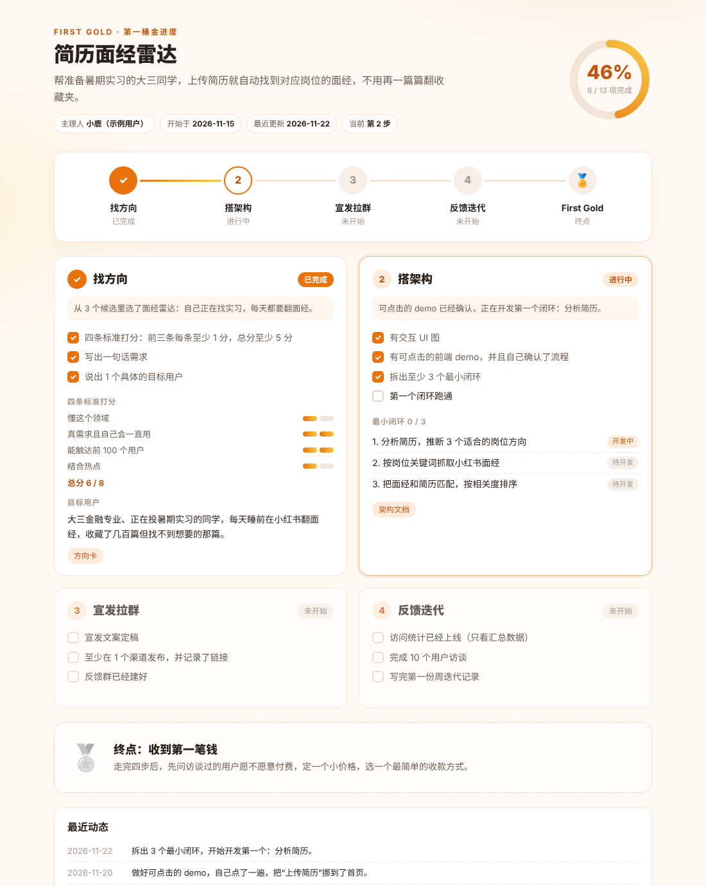

# First Gold · 用 AI 赚到你的第一桶金

First Gold 是一个 AI Agent Skill：它像一个教练，陪你从 0 做出第一个**有人用、能收到第一笔钱**的 AI 小产品。

它不会替你做决定，而是一步一步问你、给你例子、帮你守住每一步的标准，并生成一个 **HTML 进度页**，让你随时看到自己走到了哪里。



## 适合谁

- 想用 AI 做点东西，但不知道从哪开始的同学
- 有想法，却总是做到一半就烂尾的人
- 做出了 demo，却不知道怎么找到第一批用户、怎么收第一笔钱

不需要会写代码，会和 AI 聊天就行。

## 四步走到第一桶金

| 步骤 | 你会做出什么 | 过关标准 |
|---|---|---|
| ① 找方向 | 一张方向卡：一句话需求 + 四条标准打分 | 懂这个领域、真需求且自己会一直用、能触达前 100 个用户，总分至少 5/8 |
| ② 搭架构 | UI 图 → 可点击的 demo → 最小闭环 | 先确认交互，再开发；拆出至少 3 个闭环，第一个跑通 |
| ③ 宣发拉群 | 一条宣发文案 + 一个反馈群 | 文案定稿、至少在 1 个渠道发布、群已建好 |
| ④ 反馈迭代 | 访问统计 + 10 个用户访谈 + 每周迭代 | 统计上线、访谈做满 10 个、写完第一份周迭代 |
| 🏅 First Gold | 第一笔收入 | 进度页点亮“开张大吉” |

## 安装

```bash
npx skills add JoyceJin0913/first-gold
```

想在所有项目里都能用，加上 `-g` 全局安装：

```bash
npx skills add JoyceJin0913/first-gold -g
```

支持 Agent Skills 标准的工具都能用，比如 Claude Code、Codex、Cursor、CodeBuddy 等。

## 使用

```bash
/first-gold                     # 开始一个新项目
/first-gold 简历面经雷达          # 用一个项目名开始
/first-gold --resume            # 接着上次继续
/first-gold --step 3            # 直接跳到某一步
/first-gold 看进度               # 打开进度页
```

如果你用的工具不支持斜杠命令，直接说“用 first-gold 带我做一个 AI 产品”也可以。

## 会生成什么

First Gold 会在你当前的工作目录里建一个 `first-gold/` 文件夹：

```
first-gold/
├── profile.md            # 你是谁：专业、身份标签、能触达的人（下一个项目也能复用）
└── {项目名}/
    ├── progress.json     # 进度数据
    ├── progress.html     # 进度页，双击就能打开
    ├── 01-方向卡.md
    ├── 02-架构.md
    ├── 03-宣发.md
    └── 04-反馈.md
```

想先看看效果，可以打开 [`examples/mianjing-radar/`](examples/mianjing-radar/)：这是一个虚构的用户做“简历面经雷达”走到第 2 步时的样子。

## 搭配 LLM Wiki 知识库

如果你的工作目录里有 `AGENTS.md` 和 `raw/sessions/`（Karpathy 风格的 LLM Wiki 知识库），First Gold 会在每次对话结束时，把这次的决定和产出记一篇到 `raw/sessions/`，你的知识库会越用越完整。

## 几个原则

- **先问后给**：先让你自己想，卡住了再给例子，最后拍板的是你。
- **小步快跑**：先做交互原型，再让 AI 开发，开发拆成最小闭环，少烧 token。
- **说真话**：方向不行就直说，不承诺一定能赚钱。
- **保护隐私**：访问统计只看汇总数据，访谈记录不写真实姓名；抓取第三方平台内容要遵守平台规则。

## 文件结构

```
skills/first-gold/
├── SKILL.md                    # 主流程
├── references/                 # 每一步的方法、模板和提问方式
├── assets/progress-template.html
└── scripts/render.py           # 把 progress.json 渲染成进度页
```

## 致谢

进度页的思路受到 [sanyuan0704/sanyuan-skills](https://github.com/sanyuan0704/sanyuan-skills) 中 sigma 的启发。

## License

MIT
